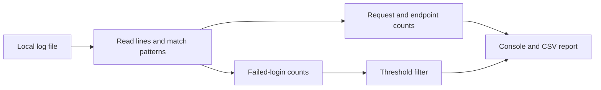

# Web Log Analyzer

**Understand request activity and repeated login failures from a local log file.**

This Python utility summarizes web-server logs and writes the results to CSV. It is a small security-analysis exercise with an inspectable parsing and reporting pipeline.

## What it reports

- Number of requests for each IPv4 address found at the start of a log line.
- The most frequently requested endpoint.
- Addresses whose matching failed-login events exceed a configurable threshold.
- A combined CSV report in `log_analysis_results.csv`.

The current failed-login parser looks for the text `"Invalid credentials"` following a status code. It does not flag every HTTP 401 automatically. The configured threshold in the sample entry point is **3**, and an address is flagged when its count is **greater than** that threshold.

## Run the included example

Python 3 is sufficient; the script uses the standard library.

```bash
python log_analysis.py
```

Run from the repository root so the script can find [`sample.log`](sample.log). It prints the analysis and writes or replaces `log_analysis_results.csv` in the current directory.

## Use as a module

```python
from log_analysis import LogAnalyzer

analyzer = LogAnalyzer("sample.log", failed_login_threshold=3)
results = analyzer.analyze()
print(results["requests_by_ip"])
analyzer.save_analysis_results(results, "my-report.csv")
```

## Architecture



[`LogAnalyzer`](log_analysis.py) separates reading, aggregation, detection, and export. To support a different log format, update the parsing patterns before interpreting its results.

## Scope

This is an offline analysis utility. A threshold match is a signal to investigate, not proof of an attack. The repository includes a sample log and a sample CSV; there is no background monitoring service or automated blocking.
